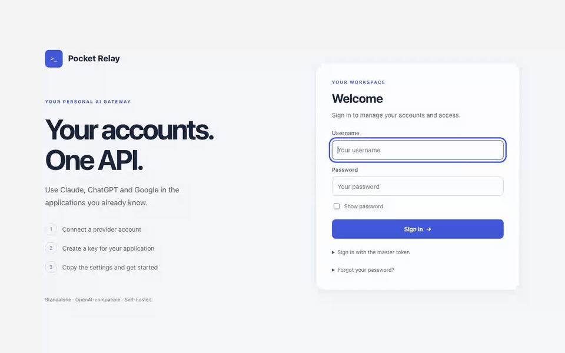
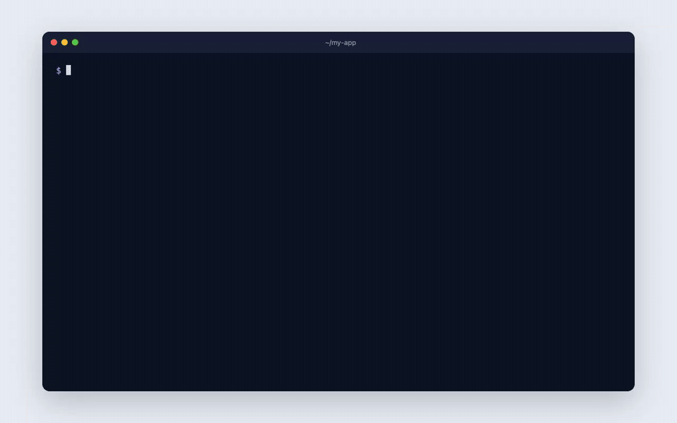

# Pocket Relay

> [!CAUTION]
> **Educational and research project. Read this before using it.**
>
> - Pocket Relay is published for **educational, research and interoperability purposes only**,
>   to study how AI command-line tools and OpenAI-compatible APIs work. It is not a commercial
>   product, not a service, and not intended for production use.
> - **Using a consumer subscription (Claude Pro/Max, ChatGPT, Google AI) through third-party
>   software may violate the provider's terms of service.** Some providers explicitly prohibit it
>   and have **suspended accounts** for it. Read your provider's current terms before connecting
>   an account. When in doubt, don't.
> - Do not use Pocket Relay to share, resell or pool subscriptions, to bypass usage limits, or
>   for any unlawful purpose.
> - You alone are responsible for how you use it, for your accounts and for compliance with the
>   terms that apply to you. The software is provided **"as is", without warranty of any kind**;
>   the author accepts no liability for account suspensions, data loss or any other damage.
> - Not affiliated with, endorsed by or sponsored by Anthropic, OpenAI, Google or Apple. All
>   trademarks belong to their owners.

**A personal gateway that connects your applications to your AI accounts.**

<p align="center">
  
</p>
<p align="center">
  
</p>
<p align="center"><sub>Demo recorded locally with simulated providers; no real account was used.</sub></p>

Pocket Relay provides a web console, password-based administration and an API compatible
with part of the OpenAI protocol. It uses the Claude Code, Codex and Antigravity CLIs to
forward requests to providers. **Models run at the provider, not on your computer**:
you need an Internet connection and a compatible account.

This is an independent, experimental project, with no affiliation with or endorsement from
OpenAI, Anthropic, Google or Apple. Provider terms may restrict or prohibit this type of
integration, including personal use. Technical compatibility does not imply permission.

## Choose an installation

| | Docker | macOS app | From source |
|---|---|---|---|
| Best for | Simple local installation | A Mac window and menu bar app | Development |
| Requirements | Docker with Compose, Git, Bash terminal | Apple Silicon Mac; see release requirements | Rust 1.97+, provider CLIs, PDF tools |
| Console | `http://localhost:8787/admin` | In the app or `http://localhost:8788/admin` | `http://localhost:8787/admin` |
| API | `http://localhost:8787/v1` | `http://localhost:8788/v1` | `http://localhost:8787/v1` |

These are alternative installation methods: **Docker is enough**. No external database,
Node.js or LiteLLM installation is required. The macOS app works without Docker and uses
the same console. Each installation keeps its own data.

**Mac app preview:** download the Apple Silicon DMG from the
[v0.4.0 release](https://github.com/als0m3/pocketrelay/releases/tag/v0.4.0).
It uses an ad hoc signature, without an Apple Developer ID or notarization; macOS requires
manual approval on first launch. No Intel DMG or App Store version is provided in this release.

The Mac app downloads a provider’s CLI only when you first add or use that provider. The console
shows installation progress and offers a retry if the download fails; installed tools are reused.

**New here? Follow the [step-by-step installation and usage guide](docs/getting-started.md)**:
install the app or Docker, connect a provider, create a key and make your first request.
The [macOS guide](docs/macos.md) covers package details and building from source.

## Get started with Docker

Start Docker Desktop, or Docker Engine with the Compose plugin on Linux. On Windows,
use a WSL terminal with Docker integration enabled.

```bash
git clone https://github.com/als0m3/pocketrelay.git
cd pocketrelay
./install.sh
```

The installer builds the image, asks for a username and a password of at least 12 characters,
and starts the service. Open **http://localhost:8787/admin**.
The first build downloads dependencies and provider CLIs and may take several minutes.
The image targets Linux x86_64; Docker Desktop emulates it on Apple Silicon.

1. **Connect an account** in the console using the provider instructions, then test it.
2. **Create an API key** for your application. Copy it when it appears and store it securely.
3. **Copy the URL, key and exact model name** from the built-in guide into your application.

You explicitly select an account through a model identifier such as `my-account/model-name`.
Copy an identifier that actually appears in the list; available models depend on the account.
Requests do not automatically fail over to another account.

## Your first Python request

Install the client in your Python environment (`pip install openai`). Set `POCKETRELAY_API_KEY`
to your local gateway key and `POCKETRELAY_MODEL` to a model identifier copied from the console.
Keep these values in your environment, never in committed code.

```python
import os
from openai import OpenAI

client = OpenAI(
    base_url="http://localhost:8787/v1",  # Use 8788 for the macOS app
    api_key=os.environ["POCKETRELAY_API_KEY"],
)
response = client.chat.completions.create(
    model=os.environ["POCKETRELAY_MODEL"],
    messages=[{"role": "user", "content": "Hello!"}],
)
print(response.choices[0].message.content)
```

Your console password and API key are different secrets. The internal master token is for
administration; do not give it to your applications.

## Everyday use

```bash
docker compose logs --tail=100   # Local diagnostics
docker compose stop            # Stop without deleting data
docker compose up -d --wait     # Start again
```

Accounts, keys and settings persist in a Docker volume. **`docker compose down -v` deletes
that volume**: do not use it for an ordinary update.
To update, back up the volume first, then run `git pull --ff-only` and `./install.sh`.
The installer preserves your existing administrator account.

Port already in use? Copy `.env.example` to `.env`, choose another `PORT`, then run the
installer again. No port is exposed to your local network by default.
The [configuration guide](docs/configuration.md) covers settings and common problems.

## Need many keys? LiteLLM is optional

Pocket Relay can already create and revoke multiple keys. Its keys grant access to **all active
accounts**; they do not provide budgets or model-specific restrictions.

For more advanced key and budget management, you can place a gateway such as LiteLLM in front:
**applications → LiteLLM → Pocket Relay → provider**. Create a dedicated Pocket Relay key for
that gateway and configure models using their exact identifiers. This is an architectural
option, not a project dependency.

If multiple users share one upstream key, disable Responses history with
`POCKETRELAY_RESPONSES_MAX_MB=0`: Pocket Relay otherwise sees them as one identity.
Adding LiteLLM does not authorize subscription sharing or resale, or change provider terms.

## How it works and its limits

- One Rust server serves the static frontend; no JavaScript build step is needed to install it.
- Chat Completions, Responses, Completions and a model catalog, with JSON or SSE streaming.
- Images and PDFs depend on provider capabilities; PDFs use Poppler or PDFKit on macOS.
- Local authentication, with optional OIDC SSO for advanced configurations.
- Claude sessions, which can act on the host machine, stay disabled in the guided installations.

OpenAI compatibility is partial: there are no embeddings, audio, image generation, files or
batches APIs. Some parameters are not forwarded to the CLIs. Tool calls are adapted through
the prompt, and JSON mode does not guarantee schema compliance.
Read the [architecture and limitations](docs/architecture.md) before integrating a demanding client.

Provider credentials are needed on disk and are not all encrypted. Read [SECURITY.md](SECURITY.md)
for storage, trust boundaries and the scope of verification. Automated tests use simulated
providers; they do not prove the availability of, or permission to use, real services.

## Development and license

The [history notes](docs/history.md) explain the imported commits and cleanup before publication.

- [Contribute and run tests](CONTRIBUTING.md)
- [Build the macOS app](docs/macos.md)
- [Third-party components](THIRD-PARTY.md)

Original Pocket Relay code is licensed under [MIT](LICENSE). Third-party components retain their
own licenses and terms. Legacy `REMOTE_*` variables and `sk-cr-` keys from earlier versions
are still accepted.

## Author's note

I am sharing this experimental project as a tool developed for my personal use.
I do not endorse abusive or unlawful use, or any use that violates the terms of the services
involved. Each user remains responsible for their accounts, data and use of the tool.
The project is provided as is, without warranty, under the MIT license. This note does not
replace provider terms or applicable legal obligations, and does not authorize bypassing them.
